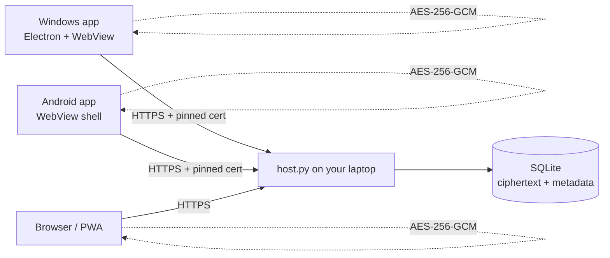

# Terminus Secrets

**A private, end-to-end encrypted chat channel that runs on your own laptop.**

Terminus Secrets gives you a Windows desktop client and an Android client that talk through a small host process on your machine. Messages are encrypted on the device that writes them, relayed as ciphertext, and stored in a single SQLite file on the host. There is no cloud account, no third-party relay, and no message content on the wire in plaintext.


---

## What you get

| Piece | Folder | What it does |
| --- | --- | --- |
| Host | [`server/`](server/) | HTTPS relay + SQLite history. Runs on the laptop. |
| Windows app | [`windows-app/electron/`](windows-app/electron/) | Native Electron window; loopback proxy with certificate pinning. |
| Windows fallback | [`windows-app/app.py`](windows-app/app.py) | Python/pywebview build of the same client. |
| Android app | [`android-app/`](android-app/) | Java + WebView shell, signed APK build, TOFU certificate pinning. |
| Web/PWA client | [`server/web/`](server/web/) | Shared encrypted UI, also installable from Chrome. |
| Packages | [`release/`](release/) | Prebuilt APK and Windows EXE (plus base64 parts if Git hosting requires text). |
| Tools | [`tools/`](tools/) | SDK setup, icon generation, protocol tests. |

---

## Why it is different

- **The relay never sees the words.** Message bodies are AES-256-GCM ciphertext before upload. The host process has no vault key.
- **The host is identifiable.** Clients pin the SHA-256 certificate fingerprint you approve during setup. A different machine on the same address cannot impersonate it.
- **Server accounts.** Create an account with a unique username and a password (minimum 10 characters) before pairing a device. Passwords are PBKDF2-HMAC-SHA256 hashed with per-account random salts; the host never stores plaintext passwords. Account sessions expire after 30 days.
- **Stable pairing details.** The pairing code is saved in `server/data/pairing-code.txt`, so restarting the host or changing networks does not rotate it. Rotate it deliberately with `python host.py --rotate-pairing-code`. The master key and vault passphrase are also stored in the host data folder.
- **Servers and channels.** Create servers, invite members, manage owner/admin/member roles, and organize public or private text channels. Server/channel names and membership are host-visible metadata; message contents are not.
- **Every device is revocable.** Pairing creates a per-device bearer token; revoke one device without touching the others.
- **The history is yours.** All chats live in `server/data/terminus.db` on this laptop. Copy that file and you have a backup.
- **Same chat, different networks.** Authentication is token-based, so changing Wi-Fi or public IP does not log you out. Remote access can use direct public IPv6 when both networks support IPv6 and inbound traffic is allowed; Tailscale or a tunnel are alternatives.

---

## Current chat controls

- Server accounts are required before device pairing: unique username + password, PBKDF2-HMAC-SHA256 password hashes, and revocable 30-day account sessions.
- Create multiple servers, join using an invite code, and switch between servers.
- Each server has owner/admin/member roles. Owners can promote/demote admins; owners and admins can create, rename, and delete channels.
- Public text channels are visible to server members. Private channels are visible to invited members; owners/admins can manage their membership, and a device paired with the host master key can also grant or revoke access for existing server members. Owners/admins retain access.
- One-to-one and group direct messages are supported. The host checks conversation membership on message sync, sending, editing, deleting, reacting, and pinning.
- Reply to messages, add/remove emoji reactions, pin/unpin messages, and edit/delete messages you authored.
- Search the currently loaded local message history, see unread counts and typing indicators, and use browser/native notifications. Mentions are highlighted and can trigger notifications.
- Attachments are encrypted on the sending device as part of the message payload. Ordinary attachments are limited to 40 KB. Voice notes are recorded for up to 10 seconds and must fit the encrypted message size limit.
- Direct-message voice calls and video calls use WebRTC peer-to-peer media. Call signaling (offer/answer/ICE) is encrypted by the client before it is stored by the host.
- Screen sharing is exposed where the platform supports `getDisplayMedia` (usually desktop Chromium/Electron). Android WebView support varies by OS/WebView version and may not expose screen capture.
- Voice/video calling is currently one-to-one in DMs, not group voice rooms. It uses a public STUN server and has no bundled TURN relay, so strict NATs, carrier filtering, or firewalls can prevent calls even when chat works.
- Message bodies, voice notes, attachments, and call signaling payloads are encrypted on the client. Server/channel names, usernames, membership, timestamps, and typing/call-routing metadata remain visible to the host.

## How it works



The vault key is derived locally:

```text
passphrase --PBKDF2-HMAC-SHA256 (600,000)--> 256-bit key
message    --AES-256-GCM (random 96-bit nonce)--> ciphertext + tag
room id    --additional authenticated data--> prevents cross-room replay
```

The host stores `nonce`, `ciphertext`, `room_id`, `device_id`, and a timestamp. It never receives the passphrase or the key.

---

## Quick start

### 1. Configure and start the host on the laptop

Requirements: Python 3.11+.

For the graphical host manager (recommended on Windows):

```powershell
cd server
python -m pip install -r requirements.txt
python settings_app.py
```

Choose whether photos, voice notes, voice calls, video calls, and screen sharing should be shown in the shared clients. The manager saves settings in `server/data/server-settings.json`, estimates RAM use, and starts/stops the host with the **Start server** button. The estimate is a planning guide, not a benchmark; actual client-side media memory varies by device and call conditions.

To run without the graphical manager:

```powershell
python host.py --port 8443
```

The vault passphrase and pairing code persist in the data folder across host restarts and network changes. The network address can still change, and remote clients need the current reachable address or a configured hostname.

The first run creates:

- `server/data/terminus.db` - all messages, encrypted
- `server/data/cert.pem` / `key.pem` - self-signed TLS identity
- `server/data/vault-passphrase.txt` - the generated vault passphrase
- `server/data/master-key.txt` - long-lived device enrollment key
- `server/data/pairing-code.txt` - the current short pairing code

When using the graphical manager, the persistent vault phrase and pairing code are shown locally in the manager after startup. The manager does not write them to its diagnostic log. When starting from a console, the host prints:

```text
This laptop :  https://127.0.0.1:8443/app/
Network     :  https://192.168.1.42:8443/app/
Public URL  :  not set (use LAN, Tailscale, or a tunnel)
Pairing code:  A1B2C3-D4E5F6
Master key  :  <long random string>
Vault phrase:  vgudo-czqgb-kxvpw-slilj
```

`Master key = add a new device. Vault phrase = decrypt history.`

Keep the window open. `Ctrl+C` stops the host; messages remain on disk.

Rotate the enrollment key without touching existing devices:

```powershell
python host.py --rotate-master-key
```

> **Security note:** the generated vault passphrase is written to `vault-passphrase.txt` for convenience. After you memorize it, delete that file and enter the phrase manually on each device. The host does not need it.

### 2. Windows

**Option A - prebuilt executable**

Run `windows-app/TerminusSecrets.exe` (or `release/TerminusSecrets.exe`).

**Option B - Electron from source**

```powershell
cd windows-app/electron
npm install
npm start
# build a portable .exe:
powershell -ExecutionPolicy Bypass -File build-exe.ps1
```

**Option C - Python fallback**

```powershell
cd windows-app
python -m pip install -r requirements.txt
python app.py
# build an .exe:
python -m PyInstaller --onefile --windowed --name TerminusSecrets --icon electron/icon.ico --collect-all webview app.py
```

On first launch:

1. Enter `https://<laptop-ip>:8443`.
2. Click **Test connection**.
3. Compare the certificate SHA-256 with the fingerprint printed by the host.
4. Click **Trust & open**.
5. Choose **Pairing code** or **Master key**, then enter that value.
6. Enter the vault passphrase and a device name.

### 3. Android

**Option A - install the APK**

Copy `android-app/TerminusSecrets.apk` (or `release/TerminusSecrets.apk`) to the phone and open it. Android asks you to allow installs from the file manager/browser; this is a self-signed personal app, not a Play Store build.

**Option B - build it**

```powershell
cd android-app
powershell -ExecutionPolicy Bypass -File build-apk.ps1
```

Requirements: JDK 17+ and Android SDK platform 34 / build-tools 34.0.0. The script uses `ANDROID_SDK_ROOT` if set, otherwise `../.android-sdk`. Run `tools/setup-android-sdk.ps1` to download the SDK pieces.

**Option C - install the PWA (no APK)**

Open `https://<laptop-ip>:8443/app/` in Chrome on Android, accept the certificate warning, then **menu -> Add to Home screen**. The same encrypted UI runs in a standalone window.

On first launch the Android app asks for the host address and shows the certificate fingerprint. Trust it once; the pin is stored in `SharedPreferences`.

### 4. Pair and chat

Enter the pairing code or paste the master key printed by the host. Then enter the vault passphrase. You can pair as many devices as you like; each gets its own token and name.

- `Enter` sends, `Shift+Enter` adds a line.
- `+` creates a group.
- **Host & devices** shows the fingerprint, paired devices, and a revoke button.
- **Lock & forget this device** wipes the token and key from that client.

---

## Windows, IPv6, HTTPS, clients, and GitHub guide

For a Windows-first walkthrough covering host setup, IPv4/IPv6 reachability, HTTPS fingerprint checks, Windows Firewall, clients, safe GitHub updates, and troubleshooting, see [`docs/WINDOWS-IPV6-HTTPS-GUIDE.md`](docs/WINDOWS-IPV6-HTTPS-GUIDE.md).

### Server roles and channel privacy

Each server has an owner, admins, and members. Only the owner can promote or demote admins; owners and admins can create, rename, or delete channels. Private channels are visible to explicitly invited accounts and server owners/admins. Owners/admins can grant or revoke access for existing server members; a device paired with the host master key can also grant or revoke private-channel membership without becoming a server owner. Direct-message and private-channel membership is enforced by the host API, not only by the interface.

## Remote access from another network

A laptop behind a home router is not reachable from the public internet by default. Choose one of these:

### Direct public IPv6 (no Tailscale or tunnel)

If the laptop has a **global IPv6 address** and the remote device also has IPv6 connectivity, clients can connect directly without Tailscale or a tunnel. The host binds to IPv6 and supports dual-stack sockets. On Windows, allow inbound TCP port 8443 in Windows Firewall and check the router/mobile provider's IPv6 inbound policy.

Find the laptop's preferred global IPv6 address in `ipconfig` (not a `fe80::` link-local address). Use square brackets around the IPv6 literal in the URL:

```text
https://[YOUR_GLOBAL_IPV6]:8443/app/
```

For example, the host health endpoint is `https://[YOUR_GLOBAL_IPV6]:8443/api/health`. Test from a genuinely external network. The outbound IPv6 reported by `curl.exe -6 https://api64.ipify.org` does not by itself prove inbound reachability. Mobile providers may block inbound traffic, and temporary IPv6 addresses can change. If the address changes, update the host URL on the clients.

See [the Windows IPv6/HTTPS guide](docs/WINDOWS-IPV6-HTTPS-GUIDE.md) for the exact checks and firewall commands.

### Recommended: Tailscale

1. Install Tailscale on the laptop and the phone.
2. Sign both into the same tailnet.
3. Start the host on `0.0.0.0:8443`.
4. Use the laptop's Tailscale IP or MagicDNS name: `https://<machine>.<tailnet>.ts.net:8443`.

Traffic is wrapped in WireGuard before it reaches the host. The certificate is still self-signed; the client pins it, so a hostname not matching the certificate SAN is fine (the Android shell proceeds only after the fingerprint check; the Windows proxy verifies the pin).

### Cloudflare Tunnel

```powershell
cloudflared tunnel --url https://localhost:8443 --no-tls-verify
```

Use the generated `https://....trycloudflare.com` URL in the client. Cloudflare presents its own certificate, so the fingerprint you trust is Cloudflare's edge certificate for that hostname. This is normal; the tunnel terminates TLS and forwards to your host.

### Port forwarding (not recommended)

If you forward 8443 on your router, you expose the host directly. Use a strong vault passphrase, keep the host patched, and prefer a tunnel. There is no account lockout beyond the pairing rate limit; the token is the only API credential.

---

## Source-folder build guides

- [Windows CMD quick start](docs/WINDOWS-CMD-QUICKSTART.md)
- [Windows app source and build](windows-app/BUILD-WINDOWS.md)
- [Android app source and build](android-app/BUILD-ANDROID.md)

Build APKs and EXEs locally from these source folders. Generated binaries are ignored by Git and do not need to be committed.

## Build and test

### Protocol smoke test

```powershell
python tools/smoke_test.py
python tools/test_master.py
```

The first test starts a throwaway host, pairs two devices, sends AES-GCM messages through the real HTTP API, decrypts them, and asserts that plaintext never appears in the data directory. The second verifies master-key enrollment and named groups.

### Windows Electron build

```powershell
cd windows-app/electron
npm install
npx electron-builder --win portable
```

Output: `windows-app/electron/dist/TerminusSecrets.exe`.

### Android build without Gradle

`android-app/build-apk.ps1` performs the full pipeline:

```text
aapt2 compile -> aapt2 link -> javac -> d8 -> add classes.dex -> zipalign -> apksigner
```

The signing key is generated on first build at `android-app/keystore/terminus-release.jks` with the password `terminus-secrets`. **Do not commit the keystore.** Keep it if you want future APKs to upgrade the installed app; otherwise Android will refuse the update.

### Android Studio

The same source opens as a normal Gradle project (`settings.gradle.kts`, `app/build.gradle.kts`). Android Studio can generate the wrapper and build a debug APK. The command-line script exists so the project can be built without Android Studio.

---

## Security model

### Protected

- Message bodies inside the encrypted payload.
- Vault passphrase and derived key never leave the client.
- Transport is TLS 1.2+ with certificate pinning on both native clients.
- Device tokens are random 256-bit values, stored only as SHA-256 hashes on the host.
- Message ciphertext is authenticated; tampering with a nonce, tag, group id, or body makes decryption fail.

### Visible to the host (metadata)

- Group names, descriptions, and ids
- Device names
- Message timestamps and sizes
- Which device sent which message
- IP addresses that connect to the host

The host is your laptop, so this is usually acceptable. If metadata privacy matters, run the host on a machine you control and treat the database as sensitive.

### Not protected against

- **A compromised host while you are using it.** Malware with access to the client process or the unlocked vault can read messages.
- **A weak or reused passphrase.** PBKDF2 slows guesses but does not make a bad passphrase strong.
- **Loss of the passphrase.** There is no recovery. The ciphertext is unreadable without it.
- **Traffic analysis** by your network or tunnel provider.
- **A compromised Android device** or a malicious keyboard/accessibility service.
- **Forward secrecy.** The vault uses one long-lived key. If the passphrase leaks later, previously captured ciphertext can be decrypted.
- **Master-key theft.** The master key only enrolls new devices; revoke suspicious devices from **Host & devices** and rotate the key with `--rotate-master-key`.

### Hardening checklist

- Delete `server/data/vault-passphrase.txt` after memorizing the phrase.
- Delete `server/data/master-key.txt` after storing the key somewhere safe (or keep it offline).
- Use a long, unique passphrase (the generated 20-character phrase is fine).
- Keep the host behind Tailscale or a tunnel; do not expose 8443 publicly.
- Back up `terminus.db` and keep the backup encrypted.
- Revoke devices you no longer use from **Host & devices**.
- Keep `cert.pem`/`key.pem` private; deleting them rotates the identity and forces every client to re-trust.

See [`SECURITY.md`](SECURITY.md) for the full threat model and reporting process.

---

## Repository layout

```text
terminus-secrets/
├── server/
│   ├── host.py                 # HTTPS relay, auth, SQLite
│   ├── requirements.txt
│   └── web/                    # shared encrypted UI + PWA
├── windows-app/
│   ├── app.py                  # Python/pywebview client
│   ├── requirements.txt
│   └── electron/               # Electron client + build script
├── android-app/
│   ├── app/src/main/           # Java + manifest + resources
│   ├── build-apk.ps1           # aapt2/javac/d8/apksigner pipeline
│   └── TerminusSecrets.apk     # signed build (if present)
├── release/
│   ├── TerminusSecrets.apk
│   └── TerminusSecrets.exe
├── docs/
│   ├── ARCHITECTURE.md
│   ├── REMOTE-ACCESS.md
│   └── USAGE.md
├── tools/
│   ├── smoke_test.py
│   ├── test_master.py
│   ├── make_icons.py
│   └── setup-android-sdk.ps1
└── .github/workflows/build.yml
```

---

## API summary

All endpoints are JSON over HTTPS. Account sign-in is required before device pairing; protected chat endpoints require both an account session and a paired-device token.

| Method | Path | Purpose |
| --- | --- | --- |
| GET | `/api/health` | Host name, version, certificate fingerprint |
| POST | `/api/accounts/register` | Create an account |
| POST | `/api/accounts/login` | Sign in |
| POST | `/api/accounts/logout` | Revoke the current account session |
| POST | `/api/pair` | Exchange a pairing code or master key for a device token |
| POST | `/api/servers/create` | Create a server and its general channel |
| POST | `/api/servers/join` | Join a server using its invite code |
| POST | `/api/servers/role` | Owner assigns admin/member roles |
| POST | `/api/rooms` | Create a public or private channel |
| POST | `/api/rooms/member` | Add a server member to a private channel |
| POST | `/api/rooms/manage` | Rename or delete a channel with owner/admin permission |
| POST | `/api/dm/open` | Open a direct or group DM |
| POST | `/api/typing` | Publish ephemeral typing status |
| GET | `/api/vault` | Salt, KDF iterations, optional vault-check blob |
| POST | `/api/vault/check` | Store the first vault-check blob |
| GET | `/api/sync?after=N&wait=S` | Long-poll messages, servers, channels, devices and typing |
| POST | `/api/messages` | Store one encrypted message |
| POST | `/api/messages/edit` | Edit a message you authored |
| POST | `/api/messages/delete` | Delete a message you authored |
| POST | `/api/messages/react` | Toggle an emoji reaction |
| POST | `/api/messages/pin` | Pin or unpin a message |
| POST | `/api/devices/revoke` | Revoke a device belonging to your account |

The host never accepts plaintext message bodies or attachment contents.

## Troubleshooting

| Symptom | Cause / fix |
| --- | --- |
| `Host unreachable` on Windows | Start `host.py`; use the exact `https://` address and port. The Windows proxy only talks to the host you trusted. |
| Android shows a certificate error | Trust the host once in the setup screen; after that the pin is enforced. If the host cert changed, clear app data and re-pair. |
| `That passphrase does not match this vault` | The vault-check blob was created with a different phrase. Use the phrase from the host that created the history. |
| `That master key is not valid` | You pasted an old key after rotation, or a key from another host. Use `data/master-key.txt` on the current host. |
| `This device is no longer authorized` | It was revoked. Pair again with a fresh code or the master key. |
| Messages arrive but show a warning | The ciphertext failed authentication: wrong key or tampered data. Do not trust that message. |
| PWA won't install | Chrome requires HTTPS; self-signed is accepted after the warning, but some Chrome versions refuse install for invalid certs. Use the APK or Tailscale. |
| Port 8756 busy (Windows) | Another copy is running; close it. The fixed port keeps browser token storage stable. |

---

## Roadmap

- Per-device key wrapping (X25519) instead of one shared vault key
- WebAuthn/Windows Hello unlock
- Optional read receipts (typing indicators are already supported and expose metadata)
- SQLite backup/export command
- iOS client

---

## License

MIT - see [`LICENSE`](LICENSE). The software is provided as-is; this is a personal communication tool, not an audited secure messenger.


## Source-only workflow (Windows)

The repository tracks source folders, scripts, configuration, icons, manifests, and lockfiles—not generated APK/EXE binaries. Build the Android APK and Windows EXE on your own PC using the commands in [`docs/WINDOWS-CMD-QUICKSTART.md`](docs/WINDOWS-CMD-QUICKSTART.md), [`android-app/BUILD-ANDROID.md`](android-app/BUILD-ANDROID.md), and [`windows-app/BUILD-WINDOWS.md`](windows-app/BUILD-WINDOWS.md). Generated outputs are ignored by Git. Do not commit signing keystores, passwords, certificates/private keys, or host data.

The Windows Electron client and Android WebView client both load the shared interface from the host at `/app/`. Shared UI changes therefore live in `server/web/`; API authorization and data rules live in `server/host.py`. Keep these in sync when adding features.

### Group administration status

Server owner/admin permissions are checked by the host for channel creation and management. Private-channel membership is enforced by the host when listing channels and syncing messages; server owners/admins can access private channels for moderation. Deleting a channel permanently deletes its stored messages. The `general` channel is protected.


## Feature and platform notes

- Accounts are unique per host (case-insensitive usernames); registration rejects duplicate names. Account credentials are not reused between different hosts.
- Saved host entries store only the host address. Reconnecting asks the user to sign in, enter the host pairing code when pairing a new device, and unlock the vault with the vault phrase; credentials are not saved in the host list.
- The vault phrase and pairing code are stored under the host's persistent `server/data/` directory and remain stable across restarts/network changes as long as that data directory is preserved. A network change can still change the public IPv6 address; without a stable DNS name or discovery/relay service, clients may need the updated address.
- Direct messages, group DMs, text channels, reactions, replies, pins, editing/deleting messages, voice notes, and one-to-one audio/video calls are implemented in the shared web client. Call signaling is encrypted by the vault in this build; voice/video media uses WebRTC's transport encryption by browser default. Screen sharing depends on browser/Electron support and user permission; Android WebView may not expose screen capture on every device.
- This is not yet feature-parity with Discord: group voice calls, push-to-talk, server discovery, robust presence/offline delivery, and reliable public-address discovery across changing mobile networks are not guaranteed.
- RAM usage depends on active calls, video resolution, browser engine, and other running applications. The project does not enforce a hard 4–5 GB process limit; treat any estimate as a target, not a measured guarantee.


## Signup and scrolling regression checks

The shared web client validates a saved account session before hiding the sign-in/sign-up form. If a saved token is expired or invalid, the client clears only that stale local session and restores the account form. The server exposes `GET /api/accounts/session` for this check; it returns account identity only and never password material.

Run the account endpoint regression test from the repository root with Python:

```powershell
python tools\test_accounts.py
```

The test covers registration, duplicate usernames, login, saved-session validation, and invalid-session rejection. The shared CSS also explicitly bounds the chat viewport and keeps messages, navigation, the account screen, and long dialogs scrollable on desktop and mobile.
