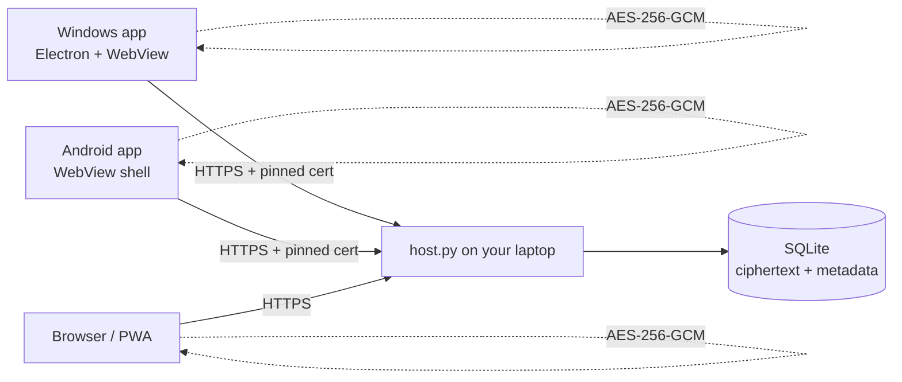

# Terminus Secrets

**A private, end-to-end encrypted chat channel that runs on your own laptop.**

Terminus Secrets gives you a Windows desktop client and an Android client that talk through a small host process on your machine. Messages are encrypted on the device that writes them, relayed as ciphertext, and stored in a single SQLite file on the host. There is no cloud account, no third-party relay, and no message content on the wire in plaintext.


---

## What you get

| Piece | Folder | What it does |
| --- | --- | --- |
| Host | [`server/`](server/) | HTTPS relay + SQLite history. Runs on the laptop. |
| Windows app | [`windows-app/electron/`](windows-app/electron/) | Native Electron window; loopback proxy with certificate pinning. |
| Windows fallback | [`windows-app/app.py`](windows-app/app.py) | Python/pywebview build of the same client. |
| Android app | [`android-app/`](android-app/) | Java + WebView shell, signed APK build, TOFU certificate pinning. |
| Web/PWA client | [`server/web/`](server/web/) | The shared encrypted UI, installable from Chrome. |
| Tools | [`tools/`](tools/) | SDK setup, icon generation, protocol smoke test. |

---

## Why it is different

- **The relay never sees the words.** Message bodies are AES-256-GCM ciphertext before upload. The host process has no vault key.
- **The host is identifiable.** Clients pin the SHA-256 certificate fingerprint you approve during setup.
- **Every device is revocable.** Pairing creates a per-device bearer token; revoke one without touching the others.
- **The history is yours.** All chats live in `server/data/terminus.db` on this laptop. Copy that file and you have a backup.
- **Same chat, different networks.** Authentication is token-based, so changing Wi-Fi or public IP does not log you out. Reachability is handled separately with Tailscale or a tunnel.

---

## How it works



```text
passphrase ──PBKDF2-HMAC-SHA256 (600,000)──▶ 256-bit key
message    ──AES-256-GCM (random 96-bit nonce)──▶ ciphertext + tag
room id    ──additional authenticated data──▶ prevents cross-room replay
```

The host stores `nonce`, `ciphertext`, `room_id`, `device_id`, and a timestamp. It never receives the passphrase or the key.

---

## Quick start

### 1. Start the host on the laptop

Requirements: Python 3.11+.

```powershell
cd server
python -m pip install -r requirements.txt
python host.py --port 8443
```

The first run creates:

- `server/data/terminus.db` — all messages, encrypted
- `server/data/cert.pem` / `key.pem` — self-signed TLS identity
- `server/data/vault-passphrase.txt` — the generated vault passphrase
- `server/data/pairing-code.txt` — the current pairing code

The console prints:

```text
This laptop :  https://127.0.0.1:8443/app/
Network     :  https://192.168.1.42:8443/app/
Pairing code:  A1B2-C3D4
Vault phrase:  vgudo-czqgb-kxvpw-slilj
```

Keep the window open. `Ctrl+C` stops the host; messages remain on disk.

> **Security note:** the generated passphrase is written to `vault-passphrase.txt` for convenience. After you memorize it, delete that file and enter the phrase manually on each device.

### 2. Windows

**Option A — prebuilt executable**

Run `release/TerminusSecrets.exe` (or `windows-app/dist/TerminusSecrets.exe` after a build).

**Option B — Electron from source**

```powershell
cd windows-app/electron
npm install
npm start
# build a portable .exe:
powershell -ExecutionPolicy Bypass -File build-exe.ps1
```

**Option C — Python fallback**

```powershell
cd windows-app
python -m pip install -r requirements.txt
python app.py
```

On first launch:

1. Enter `https://<laptop-ip>:8443`.
2. Click **Test connection**.
3. Compare the certificate SHA-256 with the fingerprint printed by the host.
4. Click **Trust & open**.
5. Enter the pairing code, vault passphrase, and a device name.

### 3. Android

**Option A — install the APK**

Copy `release/TerminusSecrets.apk` (or `android-app/TerminusSecrets.apk`) to the phone and open it. Android will ask you to allow installs from the file manager/browser; this is a self-signed personal app, not a Play Store build.

**Option B — build it**

```powershell
cd android-app
powershell -ExecutionPolicy Bypass -File build-apk.ps1
```

Requirements: JDK 17+ and Android SDK platform 34 / build-tools 34.0.0. The script uses `ANDROID_SDK_ROOT` if set, otherwise `../.android-sdk`.

**Option C — install the PWA (no APK)**

Open `https://<laptop-ip>:8443/app/` in Chrome on Android, accept the certificate warning, then **⋮ → Add to Home screen**.

On first launch the Android app asks for the host address and shows the certificate fingerprint. Trust it once; the pin is stored in `SharedPreferences`.

### 4. Pair and chat

The host prints one pairing code per run. Enter it on each device, then the vault passphrase. You can pair as many devices as you like; each gets its own token and name.

- `Enter` sends, `Shift+Enter` adds a line.
- `+` creates a channel.
- **Host & devices** shows the fingerprint, paired devices, and a revoke button.
- **Lock & forget this device** wipes the token and key from that client.

---

## Remote access from another network

A laptop behind a home router is not reachable from the public internet by default.

### Recommended: Tailscale

1. Install Tailscale on the laptop and the phone.
2. Sign both into the same tailnet.
3. Start the host on `0.0.0.0:8443`.
4. Use the laptop's Tailscale IP or MagicDNS name: `https://<machine>.<tailnet>.ts.net:8443`.

Traffic is wrapped in WireGuard before it reaches the host. The certificate is self-signed; the client pins it, so the hostname not matching the certificate SAN is fine (the Android shell proceeds only after the fingerprint check; the Windows proxy verifies the pin).

### Cloudflare Tunnel

```powershell
cloudflared tunnel --url https://localhost:8443 --no-tls-verify
```

Use the generated `https://....trycloudflare.com` URL. Cloudflare presents its own certificate, so the fingerprint you trust is Cloudflare's edge certificate for that hostname.

### Port forwarding (not recommended)

Forwarding 8443 exposes the host directly. Use a strong vault passphrase, keep the host patched, and prefer a tunnel.

---

## Build and test

```powershell
python tools/smoke_test.py
```

The test starts a throwaway host, pairs two devices, sends AES-GCM messages through the real HTTP API, decrypts them, and asserts that plaintext never appears in the data directory.

### Windows Electron build

```powershell
cd windows-app/electron
npm install
npx electron-builder --win portable
```

Output: `windows-app/electron/dist/TerminusSecrets.exe`.

### Android build without Gradle

`android-app/build-apk.ps1` performs the full pipeline:

```text
aapt2 compile -> aapt2 link -> javac -> d8 -> add classes.dex -> zipalign -> apksigner
```

The signing key is generated on first build at `android-app/keystore/terminus-release.jks` with the password `terminus-secrets`. **Do not commit the keystore.** Keep it if you want future APKs to upgrade the installed app.

### Android Studio

The same source opens as a normal Gradle project. Android Studio can generate the wrapper and build a debug APK.

---

## Security model

### Protected

- Message bodies inside the encrypted payload
- Vault passphrase and derived key never leave the client
- TLS 1.2+ with certificate pinning on both native clients
- Device tokens are random 256-bit values, stored only as SHA-256 hashes
- Ciphertext is authenticated; tampering with nonce, tag, room id, or body makes decryption fail

### Visible to the host (metadata)

- Room names and room ids
- Device names
- Message timestamps and sizes
- Which device sent which message
- IP addresses that connect

### Not protected against

- A compromised host while you are using it
- A weak or reused passphrase
- Loss of the passphrase (no recovery)
- Traffic analysis
- A compromised Android device
- Forward secrecy (one long-lived vault key)

See [`SECURITY.md`](SECURITY.md) for details.

---

## Repository layout

```text
terminus-secrets/
├── server/                  # HTTPS relay, auth, SQLite + web UI
├── windows-app/             # Electron client + Python fallback
├── android-app/             # Java/WebView app + command-line APK build
├── docs/                    # architecture, usage, remote access
├── tools/                   # smoke test, icons, SDK setup
├── release/                 # prebuilt APK/EXE + checksums
└── .github/workflows/       # CI for both packages
```

---

## API summary

All endpoints are JSON over HTTPS. `Authorization: Bearer <device-token>` is required except for `/api/health` and `/api/pair`.

| Method | Path | Purpose |
| --- | --- | --- |
| GET | `/api/health` | Host name, version, certificate fingerprint |
| POST | `/api/pair` | Exchange a pairing code for a device token |
| GET | `/api/vault` | Salt, KDF iterations, optional vault-check blob |
| POST | `/api/vault/check` | Store the first vault-check blob |
| GET | `/api/sync?after=N&wait=S` | Long-poll messages, rooms, devices |
| POST | `/api/messages` | Store one encrypted message |
| POST | `/api/rooms` | Create a channel |
| POST | `/api/devices/revoke` | Revoke a device token |

The host never accepts plaintext message bodies.

---

## Troubleshooting

| Symptom | Cause / fix |
| --- | --- |
| `Host unreachable` on Windows | Start `host.py`; use the exact `https://` address and port. |
| Android certificate error | Trust the host once in setup; after that the pin is enforced. |
| `That passphrase does not match this vault` | The vault-check blob was created with a different phrase. |
| `This device is no longer authorized` | It was revoked. Pair again with a fresh code. |
| Message shows a warning | Ciphertext failed authentication: wrong key or tampered data. |
| PWA won't install | Chrome requires HTTPS; use the APK or Tailscale. |
| Port 8756 busy (Windows) | Another copy is running; close it. |

---

## License

MIT — see [`LICENSE`](LICENSE). This is a personal communication tool, not an audited secure messenger.
