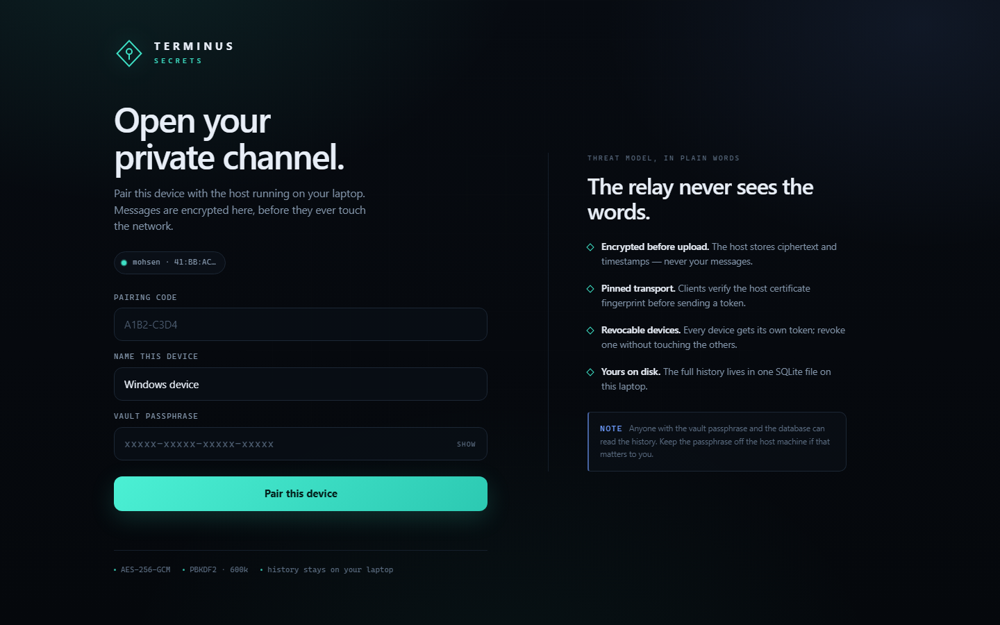
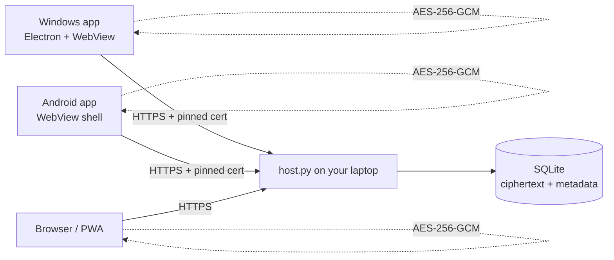

# Terminus Secrets

**A private, end-to-end encrypted chat channel that runs on your own laptop.**

Terminus Secrets gives you a Windows desktop client and an Android client that talk through a small host process on your machine. Messages are encrypted on the device that writes them, relayed as ciphertext, and stored in a single SQLite file on the host. There is no cloud account, no third-party relay, and no message content on the wire in plaintext.



---

## What you get

| Piece | Folder | What it does |
| --- | --- | --- |
| Host | [`server/`](server/) | HTTPS relay + SQLite history. Runs on the laptop. |
| Windows app | [`windows-app/electron/`](windows-app/electron/) | Native Electron window; loopback proxy with certificate pinning. |
| Windows fallback | [`windows-app/app.py`](windows-app/app.py) | Python/pywebview build of the same client. |
| Android app | [`android-app/`](android-app/) | Java + WebView shell, signed APK build, TOFU certificate pinning. |
| Web/PWA client | [`server/web/`](server/web/) | Shared encrypted UI, also installable from Chrome. |
| Packages | [`release/`](release/) | Prebuilt APK and Windows EXE (plus base64 parts if Git hosting requires text). |
| Tools | [`tools/`](tools/) | SDK setup, icon generation, protocol tests. |

---

## Why it is different

- **The relay never sees the words.** Message bodies are AES-256-GCM ciphertext before upload. The host process has no vault key.
- **The host is identifiable.** Clients pin the SHA-256 certificate fingerprint you approve during setup. A different machine on the same address cannot impersonate it.
- **Server accounts.** Create an account with a unique username and a password (minimum 10 characters) before pairing a device. Passwords are PBKDF2-HMAC-SHA256 hashed with per-account random salts; the host never stores plaintext passwords. Account sessions expire after 30 days.
- **Two ways to pair a device.** After signing in, use the short pairing code printed at startup or paste the long-lived **master key** generated by the host. Each paired device is bound to the signed-in account. Devices paired before this update must be paired again under an account.
- **Named groups.** Create groups with a name and description. Optionally set `TERMINUS_ROOM_ADMIN_KEY` on the host to require a separate host-only key for group creation; ordinary chat remains available without it. Group names and descriptions are host-visible metadata; message contents are not.
- **Every device is revocable.** Pairing creates a per-device bearer token; revoke one device without touching the others.
- **The history is yours.** All chats live in `server/data/terminus.db` on this laptop. Copy that file and you have a backup.
- **Same chat, different networks.** Authentication is token-based, so changing Wi-Fi or public IP does not log you out. Reachability is handled separately with Tailscale or a tunnel.

---

## Current chat controls

- Create multiple servers, invite members with a server invite code, switch between servers, and create channels inside a server. The first account claims the default server as owner; owners can promote members to admins or demote them back to members. Owners/admins can create and manage channels.
- Reply to a message, add/remove emoji reactions, pin/unpin messages, and edit or delete messages you authored. Changes sync to connected clients.
- Message content remains encrypted in the browser before upload. Edits replace the stored ciphertext, and deletion is a soft-delete marker so connected clients can update their view.
- Still not implemented in this pass: direct messages/group DMs, file uploads, typing indicators, full mention/search experience, and voice/video calls.

## How it works



The vault key is derived locally:

```text
passphrase --PBKDF2-HMAC-SHA256 (600,000)--> 256-bit key
message    --AES-256-GCM (random 96-bit nonce)--> ciphertext + tag
room id    --additional authenticated data--> prevents cross-room replay
```

The host stores `nonce`, `ciphertext`, `room_id`, `device_id`, and a timestamp. It never receives the passphrase or the key.

---

## Quick start

### 1. Start the host on the laptop

Requirements: Python 3.11+.

```powershell
cd server
python -m pip install -r requirements.txt
python host.py --port 8443
```

The first run creates:

- `server/data/terminus.db` - all messages, encrypted
- `server/data/cert.pem` / `key.pem` - self-signed TLS identity
- `server/data/vault-passphrase.txt` - the generated vault passphrase
- `server/data/master-key.txt` - long-lived device enrollment key
- `server/data/pairing-code.txt` - the current short pairing code

The console prints:

```text
This laptop :  https://127.0.0.1:8443/app/
Network     :  https://192.168.1.42:8443/app/
Public URL  :  not set (use LAN, Tailscale, or a tunnel)
Pairing code:  A1B2-C3D4
Master key  :  <long random string>
Vault phrase:  vgudo-czqgb-kxvpw-slilj
```

`Master key = add a new device. Vault phrase = decrypt history.`

Keep the window open. `Ctrl+C` stops the host; messages remain on disk.

Rotate the enrollment key without touching existing devices:

```powershell
python host.py --rotate-master-key
```

> **Security note:** the generated vault passphrase is written to `vault-passphrase.txt` for convenience. After you memorize it, delete that file and enter the phrase manually on each device. The host does not need it.

### 2. Windows

**Option A - prebuilt executable**

Run `windows-app/TerminusSecrets.exe` (or `release/TerminusSecrets.exe`).

**Option B - Electron from source**

```powershell
cd windows-app/electron
npm install
npm start
# build a portable .exe:
powershell -ExecutionPolicy Bypass -File build-exe.ps1
```

**Option C - Python fallback**

```powershell
cd windows-app
python -m pip install -r requirements.txt
python app.py
# build an .exe:
python -m PyInstaller --onefile --windowed --name TerminusSecrets --icon electron/icon.ico --collect-all webview app.py
```

On first launch:

1. Enter `https://<laptop-ip>:8443`.
2. Click **Test connection**.
3. Compare the certificate SHA-256 with the fingerprint printed by the host.
4. Click **Trust & open**.
5. Choose **Pairing code** or **Master key**, then enter that value.
6. Enter the vault passphrase and a device name.

### 3. Android

**Option A - install the APK**

Copy `android-app/TerminusSecrets.apk` (or `release/TerminusSecrets.apk`) to the phone and open it. Android asks you to allow installs from the file manager/browser; this is a self-signed personal app, not a Play Store build.

**Option B - build it**

```powershell
cd android-app
powershell -ExecutionPolicy Bypass -File build-apk.ps1
```

Requirements: JDK 17+ and Android SDK platform 34 / build-tools 34.0.0. The script uses `ANDROID_SDK_ROOT` if set, otherwise `../.android-sdk`. Run `tools/setup-android-sdk.ps1` to download the SDK pieces.

**Option C - install the PWA (no APK)**

Open `https://<laptop-ip>:8443/app/` in Chrome on Android, accept the certificate warning, then **menu -> Add to Home screen**. The same encrypted UI runs in a standalone window.

On first launch the Android app asks for the host address and shows the certificate fingerprint. Trust it once; the pin is stored in `SharedPreferences`.

### 4. Pair and chat

Enter the pairing code or paste the master key printed by the host. Then enter the vault passphrase. You can pair as many devices as you like; each gets its own token and name.

- `Enter` sends, `Shift+Enter` adds a line.
- `+` creates a group.
- **Host & devices** shows the fingerprint, paired devices, and a revoke button.
- **Lock & forget this device** wipes the token and key from that client.

---

## Windows, IPv6, HTTPS, clients, and GitHub guide

For a Windows-first walkthrough covering host setup, IPv4/IPv6 reachability, HTTPS fingerprint checks, Windows Firewall, clients, safe GitHub updates, and troubleshooting, see [`docs/WINDOWS-IPV6-HTTPS-GUIDE.md`](docs/WINDOWS-IPV6-HTTPS-GUIDE.md).

### Optional host-only group-creation key

To require a separate key whenever a paired client creates a group, set `TERMINUS_ROOM_ADMIN_KEY` before starting the host. This is **not** the device-enrollment master key and **not** the vault passphrase. In PowerShell:

```powershell
$env:TERMINUS_ROOM_ADMIN_KEY = "replace-with-a-long-random-secret"
python host.py --port 8443
```

Leave the variable unset to preserve the existing behavior. When enabled, the server enforces the key; client-side UI checks alone are not a security boundary. Clients prompt for the key only when the host reports that it is required. Keep the value private and use HTTPS. The current API restricts group creation; rename/delete group management is not implemented by this change.

## Remote access from another network

A laptop behind a home router is not reachable from the public internet by default. Choose one of these:

### Recommended: Tailscale

1. Install Tailscale on the laptop and the phone.
2. Sign both into the same tailnet.
3. Start the host on `0.0.0.0:8443`.
4. Use the laptop's Tailscale IP or MagicDNS name: `https://<machine>.<tailnet>.ts.net:8443`.

Traffic is wrapped in WireGuard before it reaches the host. The certificate is still self-signed; the client pins it, so a hostname not matching the certificate SAN is fine (the Android shell proceeds only after the fingerprint check; the Windows proxy verifies the pin).

### Cloudflare Tunnel

```powershell
cloudflared tunnel --url https://localhost:8443 --no-tls-verify
```

Use the generated `https://....trycloudflare.com` URL in the client. Cloudflare presents its own certificate, so the fingerprint you trust is Cloudflare's edge certificate for that hostname. This is normal; the tunnel terminates TLS and forwards to your host.

### Port forwarding (not recommended)

If you forward 8443 on your router, you expose the host directly. Use a strong vault passphrase, keep the host patched, and prefer a tunnel. There is no account lockout beyond the pairing rate limit; the token is the only API credential.

---

## Source-folder build guides

- [Windows CMD quick start](docs/WINDOWS-CMD-QUICKSTART.md)
- [Windows app source and build](windows-app/BUILD-WINDOWS.md)
- [Android app source and build](android-app/BUILD-ANDROID.md)

Build APKs and EXEs locally from these source folders. Generated binaries are ignored by Git and do not need to be committed.

## Build and test

### Protocol smoke test

```powershell
python tools/smoke_test.py
python tools/test_master.py
```

The first test starts a throwaway host, pairs two devices, sends AES-GCM messages through the real HTTP API, decrypts them, and asserts that plaintext never appears in the data directory. The second verifies master-key enrollment and named groups.

### Windows Electron build

```powershell
cd windows-app/electron
npm install
npx electron-builder --win portable
```

Output: `windows-app/electron/dist/TerminusSecrets.exe`.

### Android build without Gradle

`android-app/build-apk.ps1` performs the full pipeline:

```text
aapt2 compile -> aapt2 link -> javac -> d8 -> add classes.dex -> zipalign -> apksigner
```

The signing key is generated on first build at `android-app/keystore/terminus-release.jks` with the password `terminus-secrets`. **Do not commit the keystore.** Keep it if you want future APKs to upgrade the installed app; otherwise Android will refuse the update.

### Android Studio

The same source opens as a normal Gradle project (`settings.gradle.kts`, `app/build.gradle.kts`). Android Studio can generate the wrapper and build a debug APK. The command-line script exists so the project can be built without Android Studio.

---

## Security model

### Protected

- Message bodies inside the encrypted payload.
- Vault passphrase and derived key never leave the client.
- Transport is TLS 1.2+ with certificate pinning on both native clients.
- Device tokens are random 256-bit values, stored only as SHA-256 hashes on the host.
- Message ciphertext is authenticated; tampering with a nonce, tag, group id, or body makes decryption fail.

### Visible to the host (metadata)

- Group names, descriptions, and ids
- Device names
- Message timestamps and sizes
- Which device sent which message
- IP addresses that connect to the host

The host is your laptop, so this is usually acceptable. If metadata privacy matters, run the host on a machine you control and treat the database as sensitive.

### Not protected against

- **A compromised host while you are using it.** Malware with access to the client process or the unlocked vault can read messages.
- **A weak or reused passphrase.** PBKDF2 slows guesses but does not make a bad passphrase strong.
- **Loss of the passphrase.** There is no recovery. The ciphertext is unreadable without it.
- **Traffic analysis** by your network or tunnel provider.
- **A compromised Android device** or a malicious keyboard/accessibility service.
- **Forward secrecy.** The vault uses one long-lived key. If the passphrase leaks later, previously captured ciphertext can be decrypted.
- **Master-key theft.** The master key only enrolls new devices; revoke suspicious devices from **Host & devices** and rotate the key with `--rotate-master-key`.

### Hardening checklist

- Delete `server/data/vault-passphrase.txt` after memorizing the phrase.
- Delete `server/data/master-key.txt` after storing the key somewhere safe (or keep it offline).
- Use a long, unique passphrase (the generated 20-character phrase is fine).
- Keep the host behind Tailscale or a tunnel; do not expose 8443 publicly.
- Back up `terminus.db` and keep the backup encrypted.
- Revoke devices you no longer use from **Host & devices**.
- Keep `cert.pem`/`key.pem` private; deleting them rotates the identity and forces every client to re-trust.

See [`SECURITY.md`](SECURITY.md) for the full threat model and reporting process.

---

## Repository layout

```text
terminus-secrets/
├── server/
│   ├── host.py                 # HTTPS relay, auth, SQLite
│   ├── requirements.txt
│   └── web/                    # shared encrypted UI + PWA
├── windows-app/
│   ├── app.py                  # Python/pywebview client
│   ├── requirements.txt
│   └── electron/               # Electron client + build script
├── android-app/
│   ├── app/src/main/           # Java + manifest + resources
│   ├── build-apk.ps1           # aapt2/javac/d8/apksigner pipeline
│   └── TerminusSecrets.apk     # signed build (if present)
├── release/
│   ├── TerminusSecrets.apk
│   └── TerminusSecrets.exe
├── docs/
│   ├── ARCHITECTURE.md
│   ├── REMOTE-ACCESS.md
│   └── USAGE.md
├── tools/
│   ├── smoke_test.py
│   ├── test_master.py
│   ├── make_icons.py
│   └── setup-android-sdk.ps1
└── .github/workflows/build.yml
```

---

## API summary

All endpoints are JSON over HTTPS. `Authorization: Bearer <device-token>` is required except for `/api/health` and `/api/pair`.

| Method | Path | Purpose |
| --- | --- | --- |
| GET | `/api/health` | Host name, version, certificate fingerprint |
| POST | `/api/pair` | Exchange a pairing code or master key for a device token |
| GET | `/api/vault` | Salt, KDF iterations, optional vault-check blob |
| POST | `/api/vault/check` | Store the first vault-check blob |
| GET | `/api/sync?after=N&wait=S` | Long-poll messages, groups, devices |
| POST | `/api/messages` | Store one encrypted message |
| POST | `/api/rooms` | Create a group (name + description) |
| POST | `/api/devices/revoke` | Revoke a device token |

The host never accepts plaintext message bodies.

---

## Troubleshooting

| Symptom | Cause / fix |
| --- | --- |
| `Host unreachable` on Windows | Start `host.py`; use the exact `https://` address and port. The Windows proxy only talks to the host you trusted. |
| Android shows a certificate error | Trust the host once in the setup screen; after that the pin is enforced. If the host cert changed, clear app data and re-pair. |
| `That passphrase does not match this vault` | The vault-check blob was created with a different phrase. Use the phrase from the host that created the history. |
| `That master key is not valid` | You pasted an old key after rotation, or a key from another host. Use `data/master-key.txt` on the current host. |
| `This device is no longer authorized` | It was revoked. Pair again with a fresh code or the master key. |
| Messages arrive but show a warning | The ciphertext failed authentication: wrong key or tampered data. Do not trust that message. |
| PWA won't install | Chrome requires HTTPS; self-signed is accepted after the warning, but some Chrome versions refuse install for invalid certs. Use the APK or Tailscale. |
| Port 8756 busy (Windows) | Another copy is running; close it. The fixed port keeps browser token storage stable. |

---

## Roadmap

- Per-device key wrapping (X25519) instead of one shared vault key
- Encrypted attachments
- WebAuthn/Windows Hello unlock
- Optional read receipts and typing indicators (metadata trade-off)
- SQLite backup/export command
- iOS client

---

## License

MIT - see [`LICENSE`](LICENSE). The software is provided as-is; this is a personal communication tool, not an audited secure messenger.


## Source-only workflow (Windows)

The repository tracks source folders, scripts, configuration, icons, manifests, and lockfiles—not generated APK/EXE binaries. Build the Android APK and Windows EXE on your own PC using the commands in [`docs/WINDOWS-CMD-QUICKSTART.md`](docs/WINDOWS-CMD-QUICKSTART.md), [`android-app/BUILD-ANDROID.md`](android-app/BUILD-ANDROID.md), and [`windows-app/BUILD-WINDOWS.md`](windows-app/BUILD-WINDOWS.md). Generated outputs are ignored by Git. Do not commit signing keystores, passwords, certificates/private keys, or host data.

The Windows Electron client and Android WebView client both load the shared interface from the host at `/app/`. Shared UI changes therefore live in `server/web/`; API authorization and data rules live in `server/host.py`. Keep these in sync when adding features.

### Group administration status

Set `TERMINUS_ROOM_ADMIN_KEY` in the host process environment to require the separate key for group creation. Rename/delete are also checked server-side and require the key to be configured. The shared client prompts for the key. Deleting a group permanently deletes its stored messages. The `general` room is protected. **Groups are not private:** room membership and room-specific read authorization are not implemented, so all paired devices can see rooms and their messages.
